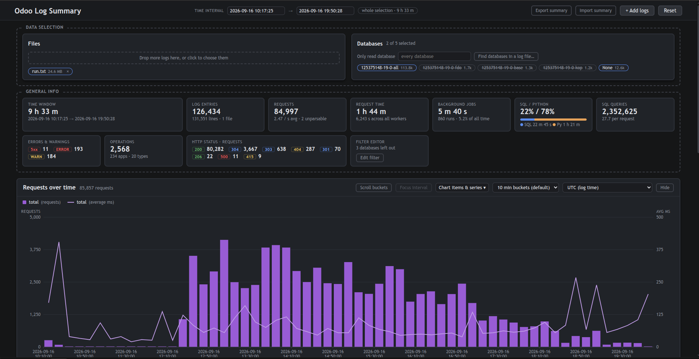

# AI Disclaimer: 
The project was fully implemented by Claude Code. All documentation beyond this paragraph is AI generated. 

# logtool

[](https://github.com/alwhi-odoo/logtool/actions/workflows/tests.yml)


Where does an Odoo server's time go? Load one or more Odoo server logs and see SQL, Python and total time per
operation, per app and per type, a requests-over-time histogram, and the most common warnings and errors.
Everything runs on your machine: the logs never leave it.



* **Operations, apps and types.** Every request is grouped into an operation (`call_kw sale.order.action_confirm`,
  `/shop/<slug>`, `cron: Mail: Email Queue Manager`), the Odoo app that owns it, and the kind of work (`ui.read`,
  `api.write`, `report`, `assets`, ...). Cron jobs, automation rules and module loading join the same tables.
* **Time split.** Odoo's access lines end with `<queries> <sql seconds> <other seconds>`, so every request's time
  splits into SQL and Python for free.
* **Histogram.** Requests and time over the whole log or any interval, down to 1-minute buckets.
* **Warnings and errors.** Grouped by message template, traced back to the request and the client they were
  logged during.
* **Details behind each row.** Client IPs, sessions, URLs, users and records that grouping collapsed. Click a value
  to filter by it.
* **A filter language.** The whole page state as one Odoo-style domain ([FILTERS.md](FILTERS.md)).
* **A shareable export.** A JSON summary without database names, file names or raw lines, with clients and logins
  pseudonymized.
* **Big logs.** Multi-GB logs are parsed in parallel and cached, and one database can be read on its own.

## Install

Python 3.9 or newer, on Linux.

```bash
git clone https://github.com/alwhi-odoo/logtool.git
cd logtool
./install.sh
```

`install.sh` puts logtool in its own virtualenv (`~/.local/share/logtool`) and links the `logtool` and
`logtool-report` commands into `~/.local/bin`, so they run from any directory. If that directory is not on your
`PATH` yet, it is added to `~/.bashrc` / `~/.zshrc`: open a new terminal afterwards. Run it again to upgrade.
`./install.sh --uninstall` removes everything it added. It also installs a release archive or wheel:
`./install.sh logtool-1.2.0.tar.gz`.

Or with pip, in a virtualenv of your own (the commands then work while it is activated):

```bash
python3 -m venv ~/.venvs/logtool && . ~/.venvs/logtool/bin/activate
pip install git+https://github.com/alwhi-odoo/logtool.git     # or, from a clone: pip install .
```

While the repository is private, cloning or installing from it needs a GitHub account with access to it.

## Run

```bash
logtool                                # http://127.0.0.1:5000, then drag log files onto the page
logtool odoo.log other.log.gz          # or preload some (plain, .gz and .bz2)
logtool --db mydb big.log              # read only database mydb's lines (see "Only read database")
logtool --port 8080 --no-browser       # another port; do not open a browser tab
python -m logtool                      # same as logtool
```

The same analysis as a text report, without a browser:

```bash
logtool-report odoo.log --top 40
logtool-report odoo.log --since 2026-09-14T13:00 --until 2026-09-14T21:00
logtool-report odoo.log --only-db mydb --csv out.csv --json out.json
logtool-report - < odoo.log            # read stdin
```

`logtool-report --help` lists every option.

Odoo writes the timing triplet on its access lines by default (werkzeug lines up to 19.0, `odoo.http.server`
lines from 19.4). Lines logged at DEBUG level (`--log-level=debug`) add the ORM call trace that the *Logged
during* views use.

## Only read database

A log of a multi-database server holds every database's lines. Set *Only read database* in the Databases box
(or start with `logtool --db NAME`) **before** loading the logs. Every other database's lines, tracebacks included,
are then skipped as soon as their header is read, so a big log loads faster and takes less memory. Lines without
a database (`?` / `None`, server start-up and the like) are always read. Changing it reads the loaded logs again.
Reset clears it.

*Find databases in a log file…* lists the databases of a plain or .gz log, with their line counts and a search
box, without loading it. The file is read in the browser (about 200 MB a second) and is not uploaded. Click a
database to read only that one. `logtool-report --only-db NAME` does the same for the text report.

## How it filters

`file -> database -> time interval`. Click a file or database to include or exclude it. Click two histogram bars
(or one bar twice), or type timestamps, to select a time interval. The first click only marks where it starts.

On top of that, *item filters* narrow single items. In the details behind an operation, app, type or warning (see
below), click values such as a client IP, a URL or a user id to keep only the occurrences that carry them. Several
values of one detail combine with OR, different details with AND. The logs are re-read with the filter (about a
second per 15 MB), and it applies everywhere: histogram, tables, statistics, raw lines and exports. Filtered rows
are marked *filtered*. The top bar's *item filters* button opens a table of them all, to clear one value, one
detail or everything. The histogram's key lists them too.

The whole page state can also be read and written as one Odoo-style domain: *General Info → Filter editor*.
Besides the filters above, it takes any condition on requests, jobs and warnings (`["http_status", ">=", 500]`,
`["duration", ">", 2]`, `["level", "=", "ERROR"]`, ...) and every view setting: the histogram's items, series,
bucket size, fit, focus and timezone, the table's grouping, search, sort and columns, the errors table's level and
search, and the collapsed panels. [FILTERS.md](FILTERS.md) documents the language.

## Histogram

*Chart items & series* lists what the chart plots: **total** (everything selected) plus one item per search term
(type it in the popup and press Enter), right-clicked table row or right-clicked warning / error. Each item has
one checkbox per series, as bars and as lines: average ms and total ms (all, Python, SQL) and requests (a warning /
error only has occurrences). New items start with bars of requests and a line of the average ms (a warning /
error: bars only). Total steps aside while other items are shown and comes back when they are removed. The key
above the chart names every series shown.

*Focus interval* shows only the selected time interval, cut out of the timeline, at a finer resolution than the
whole log allows: down to 1-minute buckets for a focus of up to a day (5 minutes up to five days), however long the
log is. *Clear focus* shows the whole timeline again. *Fit all buckets* / *Scroll buckets* switches between
squeezing every bucket into the panel and keeping bars readable with a horizontal scroll. The timezone menu
relabels the histogram only; everything else stays in the log's own clock.

## Table rows

* **Click** an operation, app or type to open a full-screen page with tabs: its numbers and example log lines
  (slowest, first, first failing), the *details behind the grouping*, its operations (for an app or type), the
  *lines logged while processing* and the *raw log lines*.
* **Right-click** to select it: it becomes a histogram item and a row of the *Selected items* table. Right-click
  again to deselect it.
* The **Select** button on its page does the same.

The *details behind the grouping* tab explains the row. An operation or message is one row because ids, clients
and numbers are collapsed, so the tab lists the values that were there, one table per detail. Click values to
filter the row by them (see *How it filters*). The details are client IPs and the accounts that logged in from
them, session ids (from Odoo 19.4), raw URLs, cron ids and run status. For a warning / error they are the numbers
behind each `#`, the user ids and records named in the message or its traceback, and the client of the request it
was logged during.

*Raw log lines* lists the operation's own lines (in log order or slowest first) or the message's occurrences.
Click one to see the lines around it in the file, color coded: the occurrence itself, other occurrences of the
same item, its parent (the request it was logged during) and what was logged during it.

Matched log lines are the lines that have no timing of their own, such as the ORM trace
`odoo.api: call stock.valuation.layer().search_read(...)` or INFO messages of add-ons. The worker that logged one
was busy with a request or cron job, and that job's own line (logged when it ends) has the timing. So the line is
matched to it by worker and time, and shows what it cost. This needs those lines in the log (`--log-level=debug`
for the ORM trace).

The *Logged during* tab of an operation, app or type also lists the users and records those lines name
(`call sale.order(42,).action_confirm()`, a warning's `(id=7)`), counted once per request. Click one to keep only
the requests that named it. For example, filter `call_button sale.order.action_confirm` by `sale.order(42)`: its
client IPs then show who confirmed order 42.

## Export summary

*Export summary* downloads a JSON copy of the selection to share. It has no database names, file names or raw
lines. Client IPs, session ids and logins become stable pseudonyms (`ip-3`, `session-1`, `user-2`); user and
record ids stay. Database and file names that appear in free text are blanked as whole words, except names shorter
than 4 characters and common words such as `odoo`. IPv4 and IPv6 addresses and email addresses are blanked too.
Operation and cron names come from the database's own configuration and are kept: skim them before sharing the
file widely.

Besides the tables, it has every distinct warning / error, the details behind each row, a timeline per cron /
automation rule, per-client activity over time, the logins, the lines per log level, and `limits`: what this
particular log cannot show (no DEBUG lines, no session per request, ...). `fields` explains each key.
*Import summary* opens one again, read-only.

## Performance

Measured on a 200 MB, 34-day log (about 1.1 million requests) on 12 cores:

| | time |
|---|---|
| load | 3 s |
| first analysis | 1 s |
| time interval | 0.1–0.5 s |
| anything already computed | ~0.05 s |
| raw log lines | 0.1–2 s |
| a new item filter or custom condition | 4–5 s |
| memory peak | about 750 MB |

Many files: 48 daily logs (2.9 GB, about 20 million lines; 12 cores, while another logtool was also parsing):

| | time |
|---|---|
| first load | 44 s |
| loading the same files again | 10 s |
| 10-day interval | 1.8 s |
| raw log lines | 0.1–4 s |
| a new item filter | 42 s |
| memory | about 1.3 GB, 3 GB with a filter |

How:

* **Many files load together.** New files are decompressed at the same time and parsed in one batch: all their
  chunks share the worker pool, instead of one file after another.
* **Parse cache.** Loading logs that were loaded before reads their parsed chunks back from
  `~/.cache/logtool/logtool-parsed`. Each entry is keyed by the file's content (its size, first and last MiB), the
  parser's own code and the *Only read database* setting, so a changed file or a new logtool version parses again.
  The cache is kept under 4 GB, and the least recently used entries go first. It is only used in a directory of
  your own that nobody else can write to. `LOGTOOL_PARSE_CACHE=0` turns it off.
* **Only read database.** The other databases' lines are skipped right after their header is matched.
* **Merging.** The main view, the histogram and time intervals merge only what they show. What an item's details
  and the export read is merged the first time it is needed.
* **Slowest first** looks only at lines whose timing could make the list. The operation's own percentile sample
  says how slow its slowest calls are, so the rest are passed over without being parsed.
* **Parsing.** Big plain-text logs are parsed in parallel chunks of up to 64 MB; the worker processes start with
  the server. Chunks are cut at the start of a log entry, so a traceback always stays with its message. A new file
  is parsed without blocking other requests.
* **Time intervals.** Each chunk's result is kept. An interval reuses the chunks inside it and re-reads only the
  two edges.
* **Memory.** Parsed chunks and merged results keep their per-minute numbers in packed arrays (about 40 bytes a
  minute instead of ~230).
* **Raw log lines** are re-read from the files. The read runs on every core, one parser chunk per process, and only
  over the chunks that overlap the time interval. *Log around it* seeks straight to the chunk holding the line.
* **Item filters and custom conditions** re-parse the selected files (in parallel, outside the lock other requests
  wait on). Only the current filter's parse is kept, so going back to an earlier filter parses again.
* **Compressed logs** (.gz, .bz2) are decompressed once to a temp file, so they get the same parallel parsing and
  seeking. Without the disk space for that, they are read in one piece and an interval re-reads the whole file.

Known limits:

* Seeking to an interval assumes log lines are at most ~3 minutes out of order.
* A warning whose request ends in the next chunk, or just outside the time interval, is not matched to it. That is
  about one request per worker per chunk boundary.
* Percentiles (p95) come from a sample of up to 20,000 calls per operation, so they are estimates on busy
  operations.

## Where files go

Uploaded logs and decompressed copies live in `~/.cache/logtool/logtool_<random>/` while the server runs and are
deleted when it stops. Folders left behind by a crash are removed at the next start. The parse cache is
`~/.cache/logtool/logtool-parsed/`. Delete that folder to drop it.

## Security

The server listens on `127.0.0.1` only. It refuses requests whose `Host` is not a loopback name (DNS rebinding)
and writes whose `Origin` is another site. `--host 0.0.0.0` exposes the loaded logs to your network and prints a
warning. See [SECURITY.md](SECURITY.md) to report a vulnerability.

## Documentation

* [FILTERS.md](FILTERS.md): the filter-domain language, for people and for agents writing domains.
* [docs/SRS.md](docs/SRS.md): the software requirements specification (what logtool must do, and why).
* [CONTRIBUTING.md](CONTRIBUTING.md): development setup, tests and how the code is organized.
* [CHANGELOG.md](CHANGELOG.md): what changed in each version.

## Tests

```bash
pip install -e ".[test]"
python -m logtool.profiler --selftest   # the parser's built-in checks
python -m pytest                        # the web app: broken files, odd input, API edge cases, intervals
python tests/test_logtool.py            # the same cases without pytest
```

## License

MIT.
